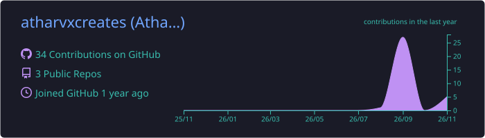
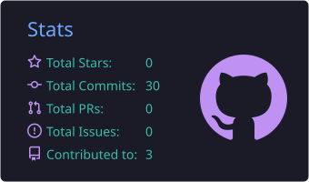
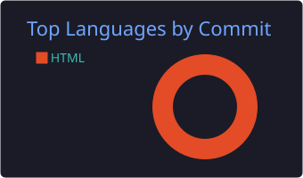
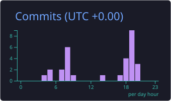

<!-- ===================== HEADER ===================== -->

  

 

<!-- ===================== ABOUT ===================== -->

<h3 align="center">✦ &nbsp;A B O U T &nbsp; M E&nbsp; ✦</h3>

Hey, I'm **Atharv**, a second-year B.Tech Information Technology student at Maharaja Surajmal Institute of Technology (MSIT), GGSIPU.

I'm working towards becoming a software developer who builds creative apps that make life easier for people, and I'm looking for internship opportunities in software development.

When I'm not coding, I edit videos, play football, and care a lot about making things genuinely easy to use. ⚽🎬

 

📍 Faridabad, India &nbsp;•&nbsp; 🎓 B.Tech IT (2025 – 2029) &nbsp;•&nbsp; 🔍 Open to internships

 

<!-- ===================== CURRENTLY ===================== -->

<h3 align="center">✦ &nbsp;W H A T &nbsp; I ' M &nbsp; U P &nbsp; T O&nbsp; ✦</h3>

| | |
|---|---|
| 🌱 **Learning** | Software development end to end: strong programming fundamentals, problem solving, and how real apps come together |
| 🛠️ **Building** | 1–2 small projects after each new concept, then one big project that brings everything together |
| 🧩 **Practicing** | DSA in C++ alongside my college curriculum |
| 🎯 **Goal** | To become a software developer who builds creative apps end to end that make life easier for people. Beyond code, I want to explore the world as a travel vlogger 🎥 and keep learning new languages 🗣️ |

 

<!-- ===================== TECH STACK ===================== -->

<h3 align="center">✦ &nbsp;T E C H &nbsp; S T A C K&nbsp; ✦</h3>

**Languages & Web**

**Tools**

&nbsp;

**Currently Learning**

 

<!-- ===================== PROJECTS ===================== -->

<h3 align="center">✦ &nbsp;F E A T U R E D &nbsp; P R O J E C T S&nbsp; ✦</h3>

<table>
  <tr>
    <td width="50%" valign="top">
      <h3>🍬 Museum of Candy</h3>
      
A fun, themed multi-section website built to practice real layout and responsive design.

      

        
        
        
        
      

      
<a href="https://github.com/atharvxcreates?tab=repositories">View on GitHub →</a>

    </td>
    <td width="50%" valign="top">
      <h3>🏥 SevaSetu</h3>
      
An offline-first, multilingual coordination layer for rural healthcare access, created for Smart India Hackathon problem statement <b>SIH26133</b> (Govt. of Maharashtra). Our team cleared the college's internal rounds.

      
<b>My role:</b> Research paper contributor &amp; presentation design

    </td>
  </tr>
</table>

🔨 More projects are on the way. Stay tuned.

 

<!-- ===================== GITHUB STATS ===================== -->
<!-- These cards are generated by .github/workflows/profile-summary-cards.yml and saved to profile-summary-card-output/ -->

<h3 align="center">✦ &nbsp;G I T H U B &nbsp; S T A T S&nbsp; ✦</h3>

 

<!-- ===================== COMMUNITY ===================== -->

<h3 align="center">✦ &nbsp;C O M M U N I T Y&nbsp; ✦</h3>

🌿 **Prakriti (NSS)**: active member of the Social Media Management team

 

<!-- ===================== BEYOND CODE ===================== -->

<h3 align="center">✦ &nbsp;B E Y O N D &nbsp; C O D E&nbsp; ✦</h3>

⚽ Football &nbsp;•&nbsp; 🎮 Gaming &nbsp;•&nbsp; 🎬 Movies & Anime &nbsp;•&nbsp; 🎵 Music &nbsp;•&nbsp; ✂️ Video Editing

 

<!-- ===================== CONNECT ===================== -->

<h3 align="center">✦ &nbsp;L E T ' S &nbsp; C O N N E C T&nbsp; ✦</h3>

I'm always happy to talk about building apps, hackathons, DSA, or internship opportunities.
 Reach out any time!

 

 

*"Consistency beats intensity. Build a little, every day."* ✨

